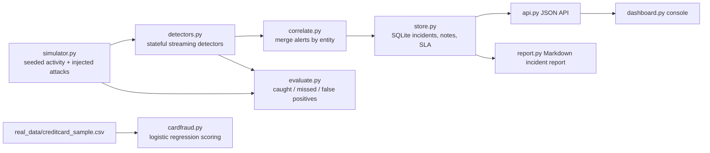

# Bank SOC Platform (simulation)

A miniature bank security operations platform written in Python (standard library only, 3.10+): a seeded activity simulator with injected attacks, streaming detectors, alert-to-incident correlation with risk scoring, an SQLite case store with triage workflow and SLA tracking, a JSON API, and a web console.

Portfolio and learning project, built with AI assistance. The attack simulator is synthetic: all customers, IPs, payees and amounts in it are made up. The `cardfraud` command runs on a real public dataset of card transactions (see `real_data/README.md` for source and licence). No real bank data is used and this is not production bank SOC experience.

## Pipeline
```
simulator -> detectors (stateful, streaming) -> correlation (union-find on entities) -> store (SQLite) -> API + console
```

## Attack scenarios injected into the simulation
| Scenario | Detector | ATT&CK |
|----------|----------|--------|
| Credential stuffing then a successful login | `credential-stuffing` (distinct failures per IP in a window, escalates on success) | T1110.004 |
| Account takeover: foreign login, password reset, new payee, large transfer | `new-payee-large-transfer` (scaled to the customer's own history) | T1657 |
| Login from two countries too fast | `impossible-travel` (haversine distance / elapsed time, with cooldown) | T1078 |
| Transfers just under the reporting threshold | `structuring` | T1657 |
| Many customers paying one payee | `mule-fan-in` | T1657 |
| Teller browsing many accounts, especially out of hours | `insider-browsing` | T1213 |
| Click on a reported phishing URL | `phishing-click` | T1566.002 |

The simulator also produces benign near-misses (a legitimate trip to the UAE, repeated rent payments, ordinary staff lookups, mistyped passwords). The tests require zero false positives on them.

## Real data: card fraud scoring
```bash
python3 -m banksoc cardfraud                    # committed sample in real_data/
python3 -m banksoc cardfraud creditcard.csv     # full 284,807-transaction public dataset
```
Logistic regression (standard library only) trained on the first 70% of the timeline and tested on the rest. On the full dataset: ROC AUC 0.98, average precision 0.81, and with a budget of 170 alerts (0.2% of transactions) 87 of 108 frauds are in the queue. Each alert lists the features that raised its score. Details and limits: `docs/card-fraud-results.md`.

## Run it
```bash
python3 -m banksoc evaluate              # scenarios caught / missed / false positives, exits 1 on a problem
python3 -m banksoc detect                # incidents with their alerts
python3 -m banksoc report 2              # Markdown report for incident 2
python3 -m banksoc simulate --out data/sample_logs.jsonl
python3 -m banksoc serve --port 8080     # console at http://127.0.0.1:8080
python3 -m unittest discover -s tests
```
Options `--seed`, `--customers` and `--days` go before the command (for example `python3 -m banksoc --days 3 detect`).

## Console and API
| Endpoint | Purpose |
|----------|---------|
| `GET /` | Single-page console: incident queue, alert details, status buttons, notes |
| `GET /api/incidents[?status=]` | Incidents, highest score first |
| `GET /api/incidents/<id>` | Detail with alerts, entities, notes |
| `POST /api/incidents/<id>/status` | `new`, `triaging`, `true_positive`, `false_positive`, `closed` |
| `POST /api/incidents/<id>/notes` | Add an analyst note |
| `GET /api/metrics` | Counts by severity and status, mean minutes to acknowledge |
| `GET /api/sla` | Incidents still `new` past their SLA (critical 15 min, high 60, medium 4 h, low 24 h) |

The server binds to localhost by default, validates input, limits body size, escapes everything it renders and sends CSP and nosniff headers. It has no authentication: do not expose it.

## Correlation and scoring
Alerts that share an entity (`user:`, `ip:`, `payee:`, `staff:`) within two hours merge into one incident. Score = sum of severity weights (critical 70, high 40, medium 15) plus 10 per extra kill-chain tactic, capped at 100. Severity bands: critical 70+, high 40+, medium 15+.

## Layout
- `banksoc/` simulator, detectors, correlate, store, api, dashboard, report, evaluate, cli
- `runbooks/alert-triage.md` response steps per alert type
- `reports/sample-incident-report.md` generated report
- `data/sample_logs.jsonl` sample simulated events
- `tests/` 29 tests: detector edge cases, window expiry, reproducibility, correlation, API behaviour including error paths

## Limitations
Single-process, in-memory sliding windows. Detectors flag once per entity. Thresholds are examples, not tuned to real bank data.

## Architecture


Detection rules with severity and mapping: [docs/DETECTIONS.md](docs/DETECTIONS.md).

## Scope and limits
**Tested**
- 29 unit tests (detector edge cases, window expiry, reproducibility with a seed, correlation, API behaviour including error paths). They run in GitHub Actions on push. I ran them locally on 26 Nov 2026: all pass. `python3 -m banksoc evaluate` on 26 Nov 2026 reported all 7 injected scenarios caught, none missed, 0 false positives on the benign near-misses.
- Detectors against the simulator the same author wrote, so the result shows the code does what it was written to do, not that it would catch real fraud. Card fraud scoring on a public sample of the Credit Card Fraud Detection dataset.

**Not tested**
- real bank traffic, load or concurrency (single process, in-memory windows), the console in a range of browsers, the full 284,807 row card-fraud dataset in this run (figures in `docs/card-fraud-results.md` come from an earlier run).

**Licence:** MIT, see `LICENSE`. Security reports: see `SECURITY.md`.
